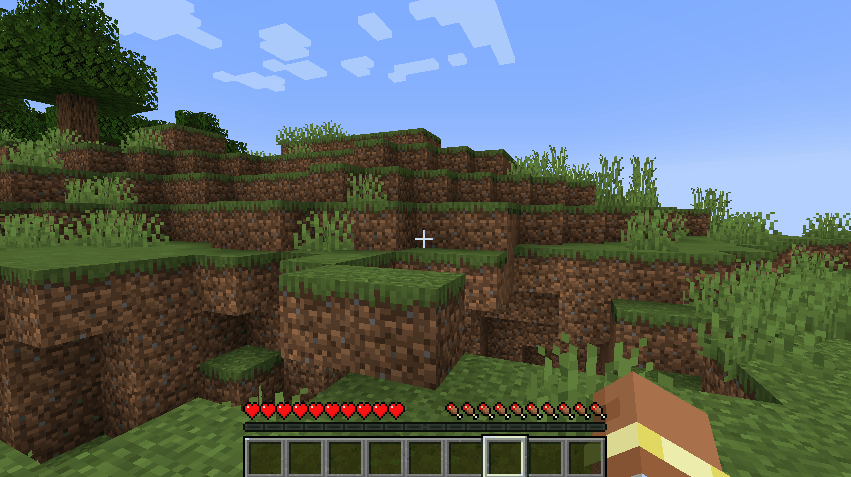
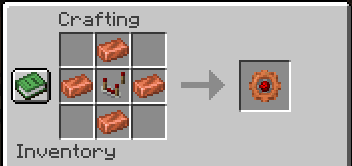
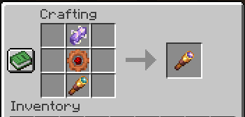

# Immersive Zoom

An immersive alternative to zooming in MineCraft, an effort to make it more 'vanilla friendly'.
Immersive Zoom was initially built as a mod for just my friend and I to have on our server because we love the cozy and immersive style of modpacks, but, I thought I would release this for other people too!



## Features

- A spyglass slot in your inventory with an assignable hotkey for zooming
- A new upgrade to the spyglass to unlock variable zoom
- Render the spyglass on your player, hooked to your belt for some extra immersion :D

<details>
<summary>Crafting recipes</summary>

**Copper Focus:** four copper ingots around a comparator



**Attuned Spyglass:** an Attuned Amethyst Shard, a Copper Focus and a spyglass



</details>

## Requirements

- Minecraft 1.21.1
- NeoForge 21.1 or newer
- Needed on both the client and the server

## Compatibility

The spyglass slot is drawn on top of the vanilla inventory rather than replacing its texture, so resource packs and other mods that change the inventory screen should still work. If you find a conflict, please open an issue.

## Building from source

```bash
./gradlew build      # jar is written to build/libs
./gradlew runClient  # launches a dev client
```

## License

MIT, see [LICENSE](LICENSE).
